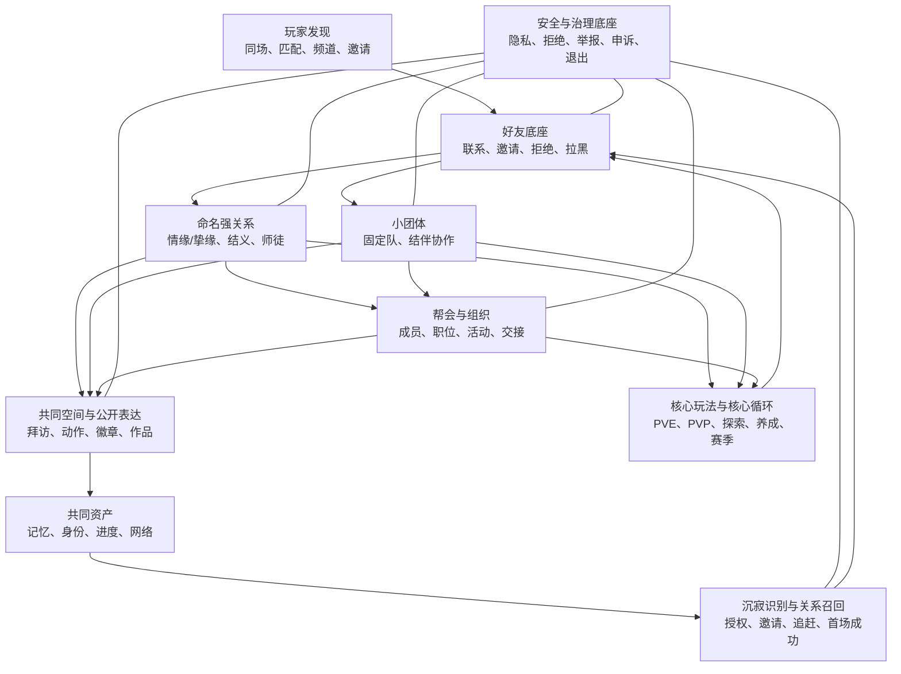
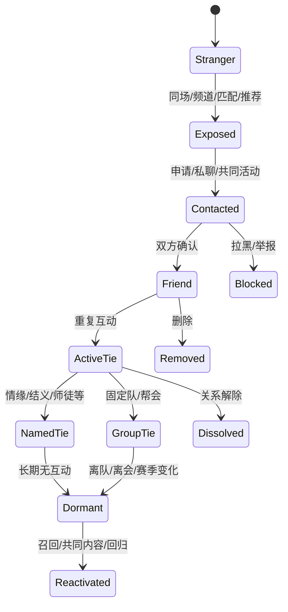
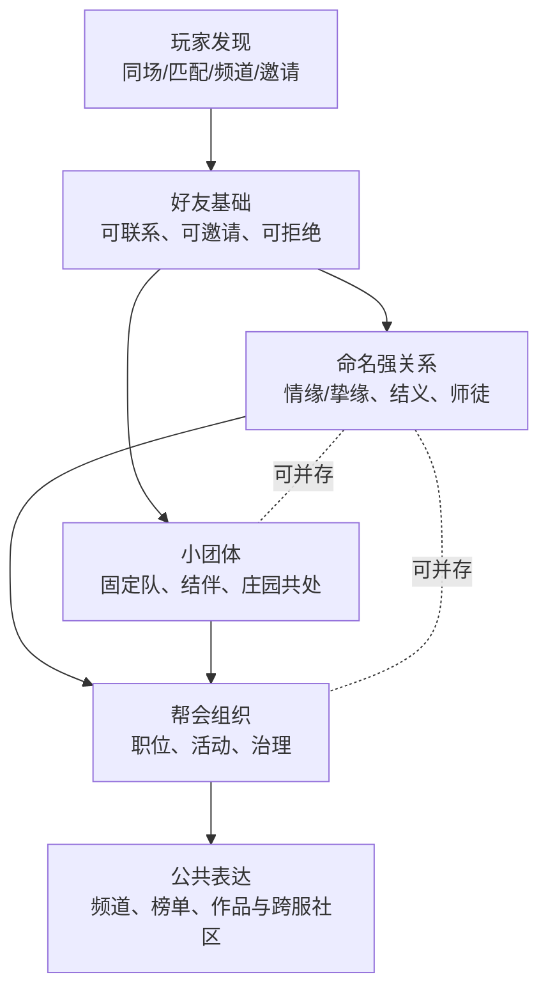
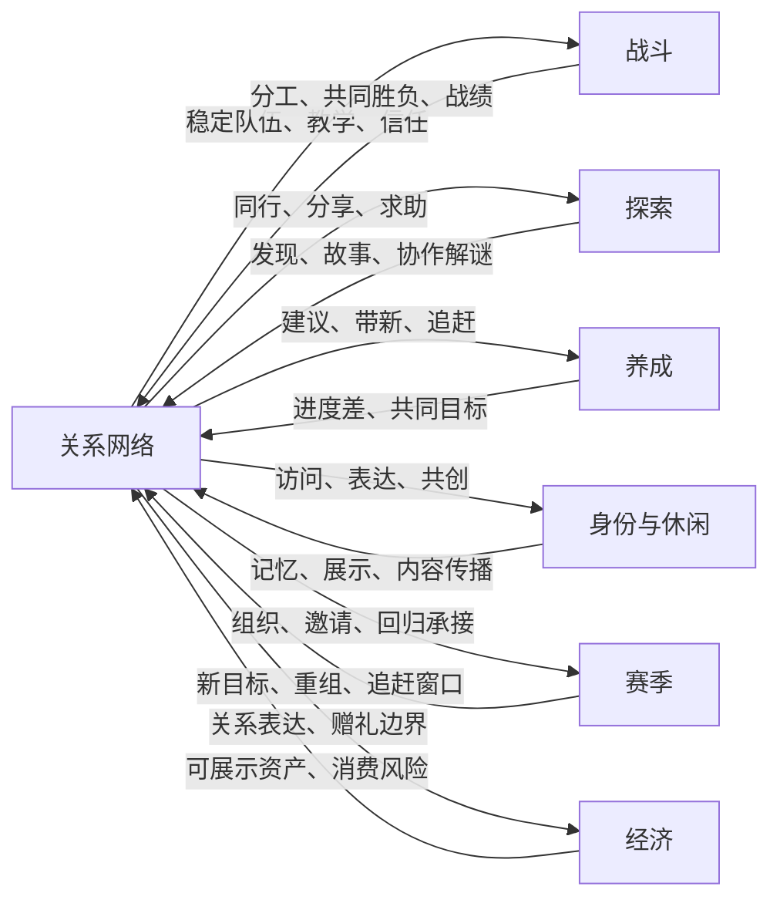
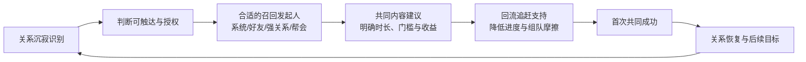

# 从好友到社会网络：以《逆水寒手游》为参考的长线游戏社交系统架构方法论

## 0. 执行摘要

> **综合分析（基于附录 A 的 [A1]-[A7] 公开资料，以及本文的方法论抽象）**：以下摘要将可复核的产品机制与作者对其关系结构、玩法连接和风险边界的判断合并呈现；其中的“价值”“作用”“可迁移结论”均不代表官方设计意图或产品内部数据。

长线商业化游戏的社交不是一个“好友、聊天、帮会”功能包，也不是在内容断档时万能的补救按钮。内容品质、核心玩法、经济价值、IP 情感、技术体验和营销事件都能驱动玩家回流；社交的特殊价值在于，它能把这些外部触发转化为可信的人际触达、可立即参与的共同内容和可被记住的共同经历。换句话说，社交不是替代内容，而是让内容在玩家网络中被重复体验、传递和保留。

> **产品事实（[A1]-[A7]）**：公开版本资料分别可确认师徒周常与风物、结伴同行中的邀请及自动好友/师徒、师徒/结义/情缘的独立关系口径、关系风物商店中的双人动作或队伍徽章、邀请/求助场景优化，以及江湖友人进入庄园和好友列表并可被召请同游等机制。各项均受其公告版本、区服与实机未复核边界约束。

> **设计分析**：将上述机制放在同一关系网络中观察，好友可被视为低成本的联系底座；师徒连接传承与进度差；情缘/挚缘、结义提供不同的身份和表达容器；组队与帮会把关系放进协作和组织治理；动作、徽章、空间访问和关系商店则让互动沉淀为记忆与可见身份。本文不将这些模块逐一赞美为“成功设计”，而是借其讨论社交网络如何从一个好友边逐步长成可持续系统。

本文的核心框架由四个对象构成：`SocialNode` 定义参与关系的主体，`SocialEdge` 定义关系类型与权限，`InteractionEvent` 记录使关系变化的互动，`SharedAsset` 保存共同记忆、身份、空间、进度和网络。它们分别对应“谁”“什么关系”“为何变化”“为何值得留下”。在此基础上，关系从陌生、被看见、接触、好友、重复互动，扩张为命名强关系、小团体、帮会和公共社会；但任何升级都必须回答普通好友为什么不够、增加了什么责任与资产、如何真实维系、如何安全退出、怎样避免奖励型假关系。

方法论的关键是双向连接。PVE、PVP、探索、养成、身份、休闲与赛季内容要为社交提供相遇、分工、故事和共同目标；社交反过来提供稳定组队、教学、信任、传播、组织和回流承接。商业化优先服务表达和纪念，谨慎对待便利，限制权力型售卖；数据上同时看建联、维系、升级、组织健康、回流和治理保护指标。最终，好的社交系统不是把玩家锁在关系中，而是让他们在可以拒绝、可以离开、也可以重新连接的前提下，拥有更多值得一起做的事。

## 1. 命题修正：社交为何重要，但不是唯一解

“只有社交能在产能黑洞或版本失误后让玩家回来”是一个有洞察、但过度绝对的命题。IP 情感、实质内容更新、核心玩法改进、经济价值、技术体验改善与营销事件都能制造回流；其中任何一项缺位都可能让关系邀请失去说服力。

社交的特殊性不在于替代这些条件，而在于它是一种可以跨版本保存、由玩家主动传递、并能让回归者立刻找到共同场景的关系资产。可信的人际触达会降低“我为什么现在回来”的解释成本；共同历史和共同目标会降低“回来后做什么”的空白；追赶机制和低摩擦共玩路径则决定这次回归会不会在第一晚再次断掉。

> **方法论抽象**：长线回流的充分条件可以写作：`触发理由 × 可信关系触达 × 可共同参与的内容 × 追赶与回归便利 × 后续目标`。任何一项接近零，整体转化都会显著变差。社交最有价值的地方，是把一次外部触发转成可继续发生的共同生活，而不是单独承担“救版本”的职责。

## 2. 分析框架：功能、关系、资产与社会结构

本章定义社交功能、社交关系、社交资产与社会结构四层概念。它们是同一个系统的不同切面，而不是四个可以各自立项的功能包。

| 层次 | 它回答的问题 | 典型例子 | 常见误判 |
| --- | --- | --- | --- |
| 社交功能 | 玩家能执行什么交互？ | 加好友、聊天、邀请、举报、拜访 | 把“有聊天”当成“有社交” |
| 社交关系 | 谁与谁形成了什么可持续连接？ | 好友、师徒、情缘、帮会成员 | 把所有关系压成一条亲密度 |
| 社交资产 | 关系沉淀了什么可被记住或使用的东西？ | 共同战绩、徽章、空间、称号、共同进度 | 把商店物品当成关系本身 |
| 社会结构 | 群体如何分工、治理、竞争和传承？ | 固定队、帮会职位、频道文化、联盟 | 只做群聊，忽略权责与新陈代谢 |

> **方法论抽象**：设计时先问“要形成何种关系和共同目标”，再选功能；先定义可以安全退出的关系，再设计升级奖励；先确定共享资产的归属，再讨论展示和付费。这个顺序把社交从功能清单转回玩家网络。

## 3. 《逆水寒手游》社交系统全景

本章按关系层级、互动场景与版本状态梳理公开可确认的社交模块。这里的重点不是把按钮收集成攻略，而是先辨认：玩家在何处相遇、以什么关系留下、靠什么重复互动，以及这段关系在退出或版本变迁后如何被处理。

### 3.1 事实口径与证据状态

本文对模块只使用以下五种证据状态：

| 证据状态 | 含义 | 正文使用方式 |
| --- | --- | --- |
| 当前公开版本可确认 | 截止日前的现行官方公告或可复核官方页面可支持 | 可作为现状案例，但仍不等同于完整后台规则 |
| 历史版本可确认，现状待实机确认 | 某个版本公告明确出现过，后续可能调整 | 只说明其历史设计意图，不推断仍常驻 |
| 官方公告转载可确认 | 完整版本公告由渠道转载，尚未找到网易原始落地页 | 标出“官方公告转载页”，不以转载站观点替代事实 |
| 玩家资料辅助，待官方或实机确认 | 只能找到攻略、Wiki 或玩家实录 | 用于定位入口，不进入决定性结论 |
| 不纳入结论 | 来源冲突、过时或无法复核 | 留在附录 B，不写为产品能力 |

### 3.2 社交模块拆解表

| 层级 | 模块 | 关系对象 | 建联入口 | 关键互动 | 维系资源 | 共同目标/资产 | 退出机制 | 核心循环连接 | 版本状态 |
| --- | --- | --- | --- | --- | --- | --- | --- | --- |
| 基础关系 | 好友与私聊 | 玩家-玩家 | 同场、组队、主动申请、邀请链接 | 私聊、邀请、状态可见 | 联系方式与共同历史 | 后续组队、关系升级的基础边 | 删除、拉黑、陌生人权限 | 组队、教学、内容分享 | 当前界面细则待实机确认；“结伴同行”自动好友可由 2.1.1 公告确认 |
| 基础关系 | 近期互动与推荐 | 玩家-玩家 | 匹配、临时协作、频道、推荐 | 再次邀请、申请好友 | 近期共同事件 | 将一次协作转成可重复联系 | 忽略、拒绝、屏蔽 | 副本、竞技、探索 | 玩家资料辅助，待官方或实机确认 |
| 强关系 | 情缘/挚缘 | 玩家-玩家 | 友好度、任务、仪式等 | 双人互动、关系表达 | 友好度、专属商店与展示 | 双人记忆与身份表达 | 解除与冷却规则待实机确认 | 休闲、拍照、外观表达 | 历史版本可确认，现状待实机确认 |
| 强关系 | 结义 | 多名玩家 | 关系申请、结义仪式 | 共同活动、结义表达 | 结义风物、徽章、动作 | 同辈团体身份 | 离开或解散规则待实机确认 | 固定协作、休闲、组织前置 | 历史版本可确认；3.1.3 公告转载可确认有结义关系表达内容 |
| 强关系 | 师徒 | 玩家-玩家，带方向性 | 拜师、结伴同行 | 教学、周常、仪式 | 羁绊值、逍遥点、师徒风物 | 新手追赶与传承 | 出师、解除规则待实机确认 | 新人引导、副本、回流 | 1.2.0 与 2.1.1 公告转载可确认 |
| 协作关系 | 临时组队与固定协作 | 多名玩家 | 匹配、好友邀请、频道 | 共同战斗、战术配合、复玩 | 共同战绩、熟悉度 | 副本或竞技共同成功 | 离队、拒绝同队 | PVE、PVP、闲趣 | 当前规则待实机确认；跨等级/段位协作由 2.1.1 公告转载可确认 |
| 组织关系 | 帮会及集体活动 | 玩家-组织-玩家 | 招募、申请、邀请 | 集体活动、职位协作、组织竞争 | 荣誉、职位、成员网络 | 组织归属与集体记忆 | 退会、解散、合服重组 | PVE、PVP、身份与资源 | 历史版本公告可确认存在帮会联赛/排名语境；现状待实机确认 |
| 共同空间 | 庄园拜访与内容表达 | 玩家-玩家/玩家-NPC | 邀请、拜访、同游 | 布置、拍照、共处、展示 | 空间内容与访问记忆 | 可被访问的个人表达资产 | 访问权限与内容治理 | 休闲、创作、邀请转化 | 江湖友人资料可确认门客进入庄园和好友列表，并可被召请同游；玩家间庄园权限待实机确认 |
| 公开表达 | 名片、称号、双人动作、关系商店、队伍徽章 | 关系双方/队伍/组织 | 关系商店、活动、主页 | 展示、拍照、登录与组队表达 | 徽章、动作、装饰 | 可见身份与纪念物 | 隐藏、切换、关系解除后的留存规则待实机确认 | 外观、休闲、社群传播 | 3.1.3 公告转载可确认双人登录动作与关系队伍徽章 |
| 拟社会关系 | 江湖友人/门客 | 玩家-AI NPC | 招募、自设角色 | 对话、同游、同副本、庄园互动 | 好感、角色设定与住所 | 陪伴感与个人叙事资产 | 私有、遣散且不可逆 | 单人探索、副本陪伴、庄园 | 官方玩法介绍及海外官网版本页可确认；不计为玩家关系网络 |
| 安全治理 | 屏蔽、举报、隐私、关系解除 | 玩家-玩家/平台 | 交互界面与设置 | 拒绝、拉黑、举报、访问控制 | 边界感与安全感 | 可持续互动的前提 | 申诉、处罚与数据处理 | 所有场景 | 1.2.0 公告转载可确认竞技战报界面的举报/不想同队；其余细则待实机确认 |

### 3.3 社交系统全景：关系、玩法、资产与治理如何闭环

> **方法论抽象**：全景图不是功能依赖图，而是社会价值的闭环图。发现使玩家获得潜在关系，好友把偶遇变成可联系对象，强关系、小团体与组织分别承接身份、协作和规模治理；玩法提供共同事件，资产使事件被记住，沉寂与召回使关系跨过版本空档。安全治理不只位于最后的客服环节，而是贯穿建联、维系、展示、退出和再连接的底座。

> **产品事实**：2023 年 1.2.0 公告描述了师徒正式结成、师徒周常、羁绊值与师徒风物奖励；2024 年 2.1.1 公告描述“结伴同行”可通过好友界面生成邀请链接，满足条件的邀请人与新角色自动成为好友及师徒（跨服例外），并获得跨等级、跨段位的部分共同参与能力。[1.2.0 更新公告（官方公告转载页）](https://bbs.4399.cn/thread-view-tid-42031631) [2.1.1 更新公告（官方公告转载页）](https://bbs.4399.cn/thread-view-tid-45300166)

> **产品事实**：策划答疑明确表述师徒、结义、情缘系统相互独立、互不干扰。[策划答疑（官方公告转载页）](https://bbs.4399.cn/thread-view-tid-41937868)

> **设计分析**：本文据此将“独立”理解为不应按一条互斥升级线建模；这不等于公告证明了它们必然共享好友、组队、展示或活动场景，相关复用关系仍需以具体版本规则或实机复核。

> **产品事实**：2025 年 3.1.3 更新公告转载页出现结义、情缘、师徒风物商店中的双人登录动作，并出现结义、师徒、情缘/挚缘队伍徽章。[3.1.3 更新公告（官方公告转载页）](https://game.xiaomi.com/viewpoint/1591139499_1756392742730_16)

> **设计分析**：双人动作与队伍徽章可被视为关系表达与记忆资产的候选载体；它们不足以单独证明全部关系规则仍未改动，也不能直接推出该类资产的留存或付费效果。

> **产品事实**：江湖友人玩法公告称，玩家自设的门客会进入庄园及好友列表，可设置私有或不可逆遣散，并可被召请同游、在单人副本中陪伴。[自捏江湖友人玩法介绍（官方公告转载页）](https://bbs.4399.cn/thread-view-tid-46145777) [海外官网 2.1.3 更新页（海外服交叉确认）](https://www.swordofjustice.com/zh-cht/news/update/20260122/40325_1283135.html)

> **设计分析**：本文将江湖友人视为拟社会关系支线：它能提供陪伴与个人叙事，但不产生玩家之间的互惠边，也不应被计入玩家关系网络的规模、关系密度或组队质量。

### 3.4 事实与推断的边界

> **设计分析**：从模块形态看，好友不是“弱关系的低配版”，而是多数后续关系与协作的地址簿、权限层和召回通路。情缘/挚缘、结义、师徒分别把亲密表达、同辈认同和知识传承命名化；它们可以并存，因此更适合建模为多轴关系，而不是把玩家塞进单一的“亲密度等级”。

> **设计分析**：关系商店、双人动作和徽章服务于“让关系被看见、被记住”，但不等于关系本身；帮会活动和组队玩法则是关系发生场，也不等于好友系统的直接子功能。混淆这两种边界，会导致策划用奖励或活动替代关系质量，最终只得到一次性的社交打卡。

> **方法论抽象**：研究任何长线游戏的社交系统时，应同时画三张图：关系图回答“谁与谁连接”，活动图回答“为什么要一起做事”，资产图回答“为什么这段关系值得留下”。三图缺一，系统就容易退化为通讯录、奖励商店或强制组队之一。

## 4. 好友：社交网络的最小可运营关系

好友不是一个只负责“存联系人”的列表。它是一条得到双方许可的、可被系统识别和维护的关系边：它让邀请、共同活动、升级关系、沉寂提醒和风险治理都有了稳定的对象。没有这条边，后续的师徒、结义、固定队或回流往往只能从零开始。

### 4.1 原子模型：四类数据对象

以下对象是本文的**方法论模型**，不是《逆水寒手游》已公开的后台表结构。

| 对象 | 定义 | 最小核心字段 | 生命周期与隐私 | 跨服/合服与解除处理 |
| --- | --- | --- | --- | --- |
| `SocialNode` | 能参与关系的主体：玩家角色、AI 关系对象、队伍、帮会 | 稳定 ID、展示身份、服务器/区服、可见性、状态 | 创建、活跃、冻结、注销；展示名与在线状态应按关系授权 | 用稳定 ID 而不是昵称做引用；重名只影响展示，不应重写关系 |
| `SocialEdge` | 两个或多个节点间的关系 | 来源、类型、方向、强度、建立时间、权限、状态 | 申请、确认、活跃、沉寂、解除、封禁；双方可见内容与单向屏蔽分开 | 跨服时保留边但降级不可用能力；合服需去重、处理容量和黑名单优先级 |
| `InteractionEvent` | 改变关系认知或可用于分析的互动事件 | 发起人、参与者、场景、时间、结果、隐私级别 | 只保留实现目的所需的最短时间；聊天、举报和未成年人数据需更严格权限 | 关系解除后，公共战绩可按规则保留，私密内容按授权隐藏或清理 |
| `SharedAsset` | 双方或群体共同拥有、共同维护或共同记忆的内容 | 所有权、成员权限、来源事件、版本、展示范围、销毁规则 | 创建、增长、继承、冻结、拆分、归档 | 关系解除时必须先定义“谁留、谁看、谁能转移”，不能临时裁决 |

> **方法论抽象**：`Node` 解决“谁”；`Edge` 解决“是什么关系”；`Event` 解决“为什么关系变化”；`Asset` 解决“为什么关系值得被保留”。如果只记录好友数量，系统无法判断是互相认识、共同战斗，还是为奖励互加后再无交互。

### 4.2 好友能力边界：从可见到可退出

| 能力 | 玩家问题 | 最小规则 | 应避免的设计 |
| --- | --- | --- | --- |
| 发现与推荐 | 我能遇见谁？ | 以同场、同队、共同兴趣或明确邀请产生候选 | 仅按战力、付费或全服热度硬推陌生人 |
| 申请、确认、拒绝 | 对方愿意建立联系吗？ | 默认双向确认；拒绝应安静、可频控 | 自动建立陌生强关系或公开羞辱拒绝者 |
| 备注、分组、置顶 | 我如何管理关系？ | 本地备注优先、可分类、可快速邀请 | 强迫双方共享备注或泄露分组意图 |
| 在线状态与可见性 | 我是否愿意被找到？ | 提供在线、隐身、活动状态等可控颗粒度 | 默认暴露精确位置、持续在线或队伍信息 |
| 私聊与快捷邀请 | 我如何把联系转成共同活动？ | 一步邀请和明确场景说明 | 让陌生私聊直达高频弹窗或组队骚扰 |
| 近期互动与共同历史 | 我如何找到值得再联系的人？ | 用共同队伍、共同内容等事件生成可管理的候选 | 把一次匹配失败永久固化为推荐关系 |
| 好友度/关系强度 | 系统如何识别重复互动？ | 以多样、双向、时间分布的有效事件估算 | 靠单边送礼或挂机快速刷满 |
| 删除、拉黑、举报、申诉 | 我如何结束不安全或不想维持的关系？ | 删除低摩擦，拉黑优先保护受影响方，举报可留证 | 用高额损失、公开提示或强制冷静期阻止退出 |
| 跨服、转服、合服与重名 | 关系能否穿过服务器边界？ | 关系 ID、显示名、可达玩法三者分离 | 将服务器迁移直接等同于“关系消失” |

> **产品事实**：2.1.1 的“结伴同行”公告把邀请链接、自动好友、跨服好友例外和跨等级/段位的部分共玩能力放在同一流程中。[2.1.1 更新公告（官方公告转载页）](https://bbs.4399.cn/thread-view-tid-45300166)

> **设计分析**：本文将这条流程作为“好友是新人进入既有关系网络的中间层”的案例，而不是把好友视为转化的结尾；该结论描述的是关系架构位置，并不意味着公告证明了该流程的实际转化效果。

### 4.3 关系生命周期状态机

> **方法论抽象**：图中的状态不是《逆水寒手游》的实际后台枚举。它用来检查一个设计是否覆盖“相遇、建联、维系、升级、沉寂、恢复、退出、安全”八个阶段。一个只有 `Friend` 与 `Removed` 的模型，无法承接关系强度、召回优先级或组织融入。

### 4.4 关系强度不等于好感数值

关系强度可以是多维判断，而不是一个让玩家无限刷取的单一数值。建议至少看四个维度：互动是否双向、是否跨越不同玩法、是否在时间上持续、是否产生了需要协调的共同结果。一次高价值副本通关和连续多周的带新，通常比同一动作重复点击更能说明关系质量；但任何强度模型都不能替代玩家的明示授权。

### 4.5 从好友向外生长的五问

每一次“把好友升级成新关系”的提案，都应通过以下检查：

1. 普通好友为什么不足以承载这个需求？
2. 新关系新增的权限、责任、共同目标或共同资产分别是什么？
3. 哪些真实互动会持续维系它，而不是只靠领奖？
4. 一方退出时，共同资产、其他成员和已承诺内容如何处理？
5. 玩家如何不靠刷奖励也能获得同等核心玩法机会？

> **设计分析**：这五问的目的不是降低关系仪式感，而是让仪式之后仍有生活。没有新权限、共同目标和低伤害退出机制的“关系升级”，往往只是把好友列表套上一层稀缺奖励壳。

## 5. 从弱关系到强关系

关系不是“越强越好”的单行道。弱关系解决发现和低成本协作，命名强关系解决稳定身份、承诺与表达；把所有玩家推向高承诺关系，反而会放大社交焦虑和退出摩擦。

### 5.1 五层关系模型

| 层级 | 典型关系 | 规模 | 主要价值 | 维系机制 | 权利/责任 | 共同资产 | 退出成本 | 主要风险 |
| --- | --- | --- | --- | --- | --- | --- | --- | --- |
| 弱关系 | 陌生人、近期队友、普通好友 | 一对一到临时多人 | 发现、尝试、低压力协作 | 同场、临时目标、轻量联系 | 可拒绝、可忽略 | 近期事件或战绩 | 低 | 骚扰、无效推荐、一次性刷分 |
| 命名强关系 | 情缘/挚缘、结义、师徒 | 双人至小规模 | 身份、亲密表达、同辈认同、知识传承 | 周期性互动、仪式、共同任务 | 约定式权限与责任 | 徽章、动作、纪念、关系进度 | 中 | 关系绑架、诈骗、攀比、假关系 |
| 小团体 | 固定队、结伴小队、庄园共同体 | 稳定小群 | 分工、默契、共同创作 | 复玩、排期、角色分工 | 成员承诺与可替补规则 | 队伍记忆、共同空间/目标 | 中 | 排他、缺人、核心成员疲劳 |
| 大型组织 | 帮会及活动组织 | 数十至更多 | 规模协作、归属、治理、竞争 | 活动、职位、文化、传承 | 明确职权、成员义务、申诉 | 组织荣誉、职位、资源、历史 | 中高 | 权力垄断、新人排斥、空壳组织 |
| 公共社会 | 频道、排行榜、内容展示、跨服社区 | 开放 | 可见性、声望、陌生人发现 | 内容、竞技、公共话题 | 公共规则与审核 | 名望、作品、公共记忆 | 低至中 | 跟风、骚扰、舆论与治理成本 |

### 5.2 统一关系生命周期矩阵

下表不把六类关系强行写成《逆水寒手游》的当前完整配置，而是以其公开可确认模块为案例背景，统一列出一个长线 MMO 必须回答的生命周期问题。标注“待实机确认”的位置不得被用作当前产品事实。

| 关系类型 | 入口 | 维系 | 共同目标 | 共同资产 | 退出 | 沉寂信号 | 召回 | 治理风险 |
| --- | --- | --- | --- | --- | --- | --- | --- | --- |
| 普通好友 | 同场、组队、申请或邀请；当前细则待实机确认 | 私聊、再次邀请、共同活动、状态授权 | 从一次协作变为可重复联系 | 备注、共同事件、近期战绩 | 删除、拉黑、陌生人权限 | 双方仍可触达但连续 N 日无双向有效互动 | 以最近共同内容或低门槛活动发起一次可拒绝邀请 | 骚扰、重复申请、隐私暴露、刷好友奖励 |
| 情缘/挚缘 | 双方同意及关系前提；当前门槛待实机确认 | 双人互动、仪式、共同纪念与表达 | 亲密陪伴、共同叙事与可选共玩 | 双人动作、纪念、关系展示 | 私密解除、冷却、展示与纪念资产处理 | 周期性互动中断、共同仪式或约定长期未完成 | 仅在触达授权内，用纪念或轻量共玩作为入口 | 情感绑架、赠礼诈骗、攀比、解除羞辱 |
| 结义 | 多人同辈的申请与仪式；具体规模待实机确认 | 团体活动、共同记录、身份表达 | 同辈归属、稳定协作、共同叙事 | 团体名称、徽章、动作、历史记录 | 离开、解散与名称/记录归属规则 | 成员持续缺席、团体无共同事件、核心成员离开 | 由同辈成员或团体纪念触发小范围邀请 | 小圈子排他、奖励刷取、群体压力、成员排斥 |
| 师徒 | 拜师或结伴同行等路径；历史公告可确认部分链路 | 教学、周常、反馈、成长陪伴 | 降低理解与进度差，完成传承或出师 | 羁绊、风物、教学里程碑、共同记录 | 出师、解除、保护学徒自主性 | 学习者停留在求助但无完成，或导师长期不响应 | 以未完成教学目标、追赶支持或低压力共同任务承接 | 代练、强迫陪玩、身份压迫、奖励套利 |
| 固定队 | 匹配后复邀、好友邀请、招募或频道；具体功能待实机确认 | 复玩、分工、排期、替补和复盘 | 稳定完成副本、竞技、探索或赛季目标 | 队伍约定、战绩、分工记录、共同回忆 | 离队、踢人、替补、解散 | 成员缺席频率提高、开团失败率上升、替补长期不足 | 由熟人发起短时低门槛回归场，明确可替补而非全勤 | 排他筛选、缺人停摆、指挥霸权、时间绑架 |
| 帮会 | 招募、申请、邀请；现行准入规则待实机确认 | 集体活动、职位协作、文化、成员交接 | 组织归属、规模协作、竞争与传承 | 荣誉、职位、组织记录、可审计资源 | 退会、解散、交接、个人关系保留 | 新人七日沉默、活动参与下降、职位长期空转或资源集中 | 分层欢迎、替补位、旧成员低压首场活动与关系链邀请 | 资源垄断、新人排斥、空壳组织、骚扰、合服重组断裂 |

> **方法论抽象**：生命周期矩阵的作用是强制把“建一段关系”与“让关系安全地存续、沉寂、退出或重启”写在同一张表里。若一个关系只有入口、奖励和展示，而没有沉寂信号、可拒绝召回与退出规则，它在产能波动或玩家生活节奏变化时就会成为负担，而不是长线资产。

> **方法论抽象**：虚线强调命名强关系不是组织晋升的必经门槛。玩家可以在没有情缘或结义的情况下做出色的固定队成员、帮会导师或公共内容创作者；反过来，亲密关系也不应被组织 KPI 接管。

### 5.3 用同一模板拆解三种命名强关系

| 维度 | 情缘/挚缘 | 结义 | 师徒 |
| --- | --- | --- | --- |
| 形成前提 | 双方同意、关系进度与仪式条件以实机为准 | 同辈玩家的多人约定，规模以实机为准 | 资历差异、双方同意、教学或出师流程 |
| 关系规模和方向性 | 通常是双向亲密关系 | 多人、同辈、非排他的团体关系 | 有方向性：传授与学习，但必须保持尊重和可退出 |
| 核心互动 | 双人体验、纪念、表达 | 共同行动、集体身份、队伍默契 | 教学、带玩、任务反馈、成长陪伴 |
| 关系成长 | 共同经历与表达资产 | 团体互动和共同记忆 | 学习者的可验证成长、导师的有效帮助 |
| 共同目标 | 共同叙事与陪伴 | 同辈归属与协作 | 缩短理解和追赶成本 |
| 关系表达 | 双人动作、主页、纪念、外观 | 徽章、动作、共同称号 | 仪式、称号、师徒风物 |
| 共同资产 | 纪念物、照片、可见身份 | 团体名称、徽章、共同记录 | 教学里程碑、师徒纪念与成长记录 |
| 与玩法连接 | 休闲、拍照、轻协作 | 固定协作、组织融入、闲趣 | 新手引导、副本教学、回流追赶 |
| 商业化边界 | 表达和纪念可售，不能出售情感承诺 | 团体表达可售，不能把权利和收益绑定付费 | 外观表达可售，不能付费买教学资格或成长特权 |
| 解除与冷却 | 需要私密、清晰、低羞辱的解除路径 | 应处理成员、名称和群体资产 | 应保护学徒自主性，不能被惩罚式绑定 |
| 风险 | 情感压力、赠礼诈骗、攀比 | 小圈子排他、奖励刷取 | 代练式利用、强迫陪玩、身份权力压迫 |

> **产品事实**：官方答疑说明师徒、结义、情缘相互独立、互不干扰；1.2.0 版本公告确认师徒有仪式、周常与风物兑换；3.1.3 公告转载确认三类关系分别具有可兑换的双人登录动作或队伍徽章。[策划答疑（官方公告转载页）](https://bbs.4399.cn/thread-view-tid-41937868) [1.2.0 更新公告（官方公告转载页）](https://bbs.4399.cn/thread-view-tid-42031631) [3.1.3 更新公告（官方公告转载页）](https://game.xiaomi.com/viewpoint/1591139499_1756392742730_16)

> **设计分析**：三条关系轴的差异不在“哪家商店发什么”，而在它们解决的社会问题不同：情缘/挚缘偏向公开或私密的亲密表达，结义偏向同辈团体认同，师徒偏向知识与进度差的桥接。让三者共用好友、活动和表达底座，允许多轴并存，才能避免强迫玩家把所有重要关系命名成同一种关系。

### 5.4 小团体：把偶遇变成可重复协作

固定队的价值不是让匹配失效，而是减少重复解释、提高分工默契、沉淀共同节奏。它需要三个比“组个群”更具体的能力：一是 **可替补**，避免少一人就整体停摆；二是 **低承诺回归**，允许工作忙、赛季换玩法的成员重新接上；三是 **共同记录**，让成功、失败和约定有可回看的记忆，而不是只剩即时语音。

庄园、拍照或闲趣共处等空间可以承担低压力的关系维护：当日常副本不再提供新鲜目标时，成员仍能以创作、访问和展示维持可见联系。但空间不应被误判为自动的“共建事实”；具体权限和共同建设规则必须以实机确认。

## 6. 从小团体到大型组织

从小团体到帮会，变化不是人数变大，而是系统开始面对角色分工、信息不对称、成员流动与权力边界。好友关系可以靠双方默契，组织关系必须依赖明确规则。

### 6.1 帮会的六个治理面

| 治理面 | 设计问题 | 最小能力 | 失效信号 |
| --- | --- | --- | --- |
| 招募与新人融入 | 新人如何从“占名额”变成成员？ | 兴趣/时段标签、欢迎流程、首场共同活动、导师/联系人 | 新人只领福利、七日内无有效互动 |
| 权限与职位 | 谁能招人、发起活动、管理资产？ | 最小权限、操作日志、交接与申诉 | 单人永久控制、权责不对称 |
| PVE/PVP/休闲活动 | 不同动机成员能否都找到位置？ | 多轨活动、报名、替补、低压参与 | 只奖励高强度核心团，休闲成员沉默 |
| 资源与荣誉 | 共同资源如何分配？ | 透明规则、可查记录、贡献口径分层 | 黑箱分配、资源被少数人截留 |
| 核心与普通成员 | 高投入成员如何被认可而不垄断？ | 角色轮换、临时授权、培训后备 | 核心疲劳、普通成员永无上升空间 |
| 解散、离会与重组 | 赛季、合服或冲突后如何保持尊严？ | 低摩擦退会、资产规则、关系保留、重组入口 | 成员被锁定、组织空壳仍占据资源 |

> **产品事实**：早期版本更新公告可确认《逆水寒手游》有帮会联赛、帮会潜力榜排序等组织竞争语境。[1.2.0 更新公告（官方公告转载页）](https://bbs.4399.cn/thread-view-tid-42031631)

> **设计分析**：该类历史公告不足以证明当前职位、资源和合服规则。因此本文把帮会作为组织设计案例，而把具体活动制度留在“待实机确认”，避免用历史活动语境替代现行制度事实。

### 6.2 公共社会不是大型好友列表

频道、排行榜、内容展示和跨服社区的作用是让陌生人被看见，并让声望、作品与组织文化发生扩散。它们应与私密关系层分开：公开空间需要更高的举报、屏蔽、内容审核与反骚扰能力；私密关系则优先保护邀请边界和退出尊严。把公共曝光直接变成陌生私聊许可，通常会让愿意表达的玩家先退出。

> **方法论抽象**：组织健康的定义不是成员数最大，而是新人有进入路径、普通成员有可见价值、核心成员能轮换、冲突有出口、离开后仍可保留个人关系。只要其中任何一项长期缺失，组织再热闹也可能只是高压的活动机器。

## 7. 共同空间、公开表达与关系记忆

关系要跨过内容空档，必须留下一些不依赖当天副本掉落的东西。共同空间、公开表达与关系记忆并不是“装饰性末端”，而是把一次互动变成可回看、可展示、可继续维护的社会资产。

### 7.1 六类共同资产

| 资产类别 | 内容 | 主要价值 | 归属与退出原则 | 商业化警戒线 |
| --- | --- | --- | --- | --- |
| 记忆资产 | 照片、纪念、共同战绩、事件记录 | 让共同经历可回看、可召回 | 应允许个人保留自己的记忆副本；私密内容默认不公开 | 不出售“情感真实性”，只可售记录载体或装饰 |
| 身份资产 | 称号、徽章、关系展示、组织职位 | 让关系或贡献被识别 | 关系解除后展示与保留规则要预先说明 | 不能付费买战斗地位或组织权威 |
| 空间资产 | 庄园、布置、访问、内容场景 | 提供低压力共处和创作场 | 访问权限、共同编辑、回收与归档要独立设置 | 装饰可售，基础访问与安全不能付费墙化 |
| 进度资产 | 关系等级、共同任务、组织建设 | 形成下一次互动目标 | 不应因单方退出无条件清零另一方贡献 | 避免付费跳过真实互动门槛 |
| 经济资产 | 赠礼、共享资源、组织资金、商业化物品 | 支撑仪式与共同消费 | 需要交易记录、限额、冻结与纠纷处理 | 严防赠礼欺诈、情感勒索和代付压力 |
| 网络资产 | 好友网络、固定队、帮会、跨服关系 | 提供发现、协作与召回通路 | 玩家可带走个人关系；组织不应锁定社交图谱 | 不把社交可达性售卖给付费玩家 |

> **产品事实**：公开玩法资料可确认江湖友人的门客会进入庄园和好友列表，并可被召请同游；3.1.3 公告转载页可确认关系商店提供双人登录动作、关系队伍徽章等可见表达。[江湖友人玩法介绍（官方公告转载页）](https://bbs.4399.cn/thread-view-tid-46145777) [3.1.3 更新公告（官方公告转载页）](https://game.xiaomi.com/viewpoint/1591139499_1756392742730_16)

> **设计分析**：门客进入庄园与被召请同游是两项并列的已公开能力，不能推导为“庄园承接同游”。本文仅据此将庄园视为可能承接访问、表达与个人叙事的空间案例；玩家之间庄园共建、共同编辑与权限细则仍须实机确认。

### 7.2 可见性是权限，不是默认奖励

公开表达能帮助玩家发现同好、传播内容与建立身份，但它必须建立在可控可见性上。玩家应能分别决定：谁能看见自己的在线状态、空间、关系展示、作品、共同记录和邀请入口。尤其当表达与亲密关系相连时，“默认公开”会把本来用于陪伴的系统变成压力源。

## 8. 社交与核心玩法、核心循环的双向连接

社交系统的价值不在于把每个玩法强制改成多人，而在于让玩法提供真实的相遇、协作和故事，让关系网络反过来降低协作成本、承接成长差异、传播内容并保留回归入口。只有双向交换成立，关系才不会在奖励结束后立刻失活。

### 8.1 双向交换模板

每个核心循环都用两句检查：

- **玩法向社交提供**：相遇场景、共同目标、压力、分工、奖励或故事。
- **社交向玩法提供**：组队稳定、教学、信任、传播、竞争、组织和回流。

如果只能写出前一句，说明这是“玩法附带聊天”；如果只能写出后一句，说明设计者正试图让社交替代玩法内容。

### 8.2 核心循环关联矩阵

| 核心循环 | 社交发生场 | 需要的关系层级 | 玩法提供的社交价值 | 社交反哺玩法 | 失败风险 | 验证指标 |
| --- | --- | --- | --- | --- | --- | --- |
| PVE 副本 | 匹配、组队、固定队、师徒教学 | 临时队到固定队 | 分工、容错、共同失败与共同成功 | 更快成队、知识传递、复玩意愿 | 不组队无法完成、老手只筛选新人 | 社交组队率、教学成功率、固定队复玩率 |
| PVP 与组织竞争 | 队伍、帮会、跨服活动 | 固定队、帮会、公共社会 | 对抗、指挥、荣誉与集体目标 | 战术信任、组织动员、内容传播 | 组织垄断、战力排斥、挫败外溢 | 组织参与率、替补率、不同强度分层留存 |
| 大世界探索 | 同场、求助、分享、同游 | 弱关系、好友、小团体 | 发现、协作解谜、偶发故事 | 信息扩散、回访、共同记忆 | 把探索做成强制跟队打卡 | 发现分享率、被邀请后的完成率 |
| 角色与装备养成 | 师徒、结伴、求助、好友建议 | 好友、师徒、组织 | 成长差异、搭配讨论、追赶需求 | 带新、方案解释、降低理解门槛 | 用强者施舍替代正常追赶 | 新人首周共同活动率、求助解决率 |
| 身份、副职业与玩家服务 | 交易前外的服务、教学、展示 | 弱关系到公共社会 | 角色分工、可被需要的技能 | 形成声望和重复联系 | 把服务变成骚扰或灰产入口 | 服务发起/完成率、复购式协作率、投诉率 |
| 休闲、庄园、拍照和内容表达 | 拜访、双人动作、创作、展示 | 好友、强关系、小团体 | 低压力共处、表达、纪念 | 维持非战斗时段的关系可见性 | 只剩打卡与付费晒图 | 共同创作率、访问回访率、表达后互动率 |
| 赛季与版本活动 | 回归、追赶、组织重组、邀请 | 好友、师徒、帮会 | 新目标、旧关系重聚、进度差显性化 | 召回触达、组织再组织、首场共同成功 | 新人被赶进度、回归后无承接 | 关系链回流率、回流七日共同活动率 |

> **产品事实**：2.1.1 的“结伴同行”把邀请关系、新角色跳过部分前置、解锁若干玩法权益、自动好友/师徒，以及跨等级/段位的部分共玩能力放在同一流程中；公告还说明段位差距过大时高段位方无法获得段位分数。[2.1.1 更新公告（官方公告转载页）](https://bbs.4399.cn/thread-view-tid-45300166)

> **设计分析**：本文据此认为，该版本的邀请链同时配置了追赶与竞技公平边界，而非只提供邀请奖励。这是对该历史版本机制组合的结构判断，不能外推为当前版本效果或官方唯一目的。

> **产品事实**：3.3.2 公告转载页可见“求助变强”相关优化，以及社交关系私聊/组队、庄园、棋牌等邀请场景的皮肤覆盖语境。[3.3.2 更新公告（官方公告转载页）](https://community-cn.honor.com/cngm/game/topicdetail/topicid-3722716494888961)

> **设计分析**：该资料可以作为“求助与邀请可能分布在多个产品入口”的案例线索，但不足以证明完整的现行社交链路，也不应用来推断各入口的使用率。

### 8.3 四种连接位置：前置、过程、结果、传播

同一玩法可以处于不同的社交位置，设计必须说清楚是哪一种。

| 位置 | 含义 | 合理用法 | 不合理用法 |
| --- | --- | --- | --- |
| 前置 | 先有关系或队伍，才更易进入玩法 | 固定队报名、师徒共同挑战 | 用好友数量卡住主线或核心奖励 |
| 过程 | 玩法进行时需要协作与沟通 | 副本分工、竞技战术、探索解谜 | 把单人可理解内容强制语音协作 |
| 结果 | 玩法结束后产生关系或资产 | 近期队友、共同战绩、纪念照片 | 失败一场就自动强加好友关系 |
| 传播 | 关系网络帮助内容被再次看见 | 展示、邀请、帮会活动、同游分享 | 用频繁弹窗逼好友转发 |

### 8.4 单人路径与固定关系的差异

单人玩家必须能完成核心成长与主要体验；社交的价值应体现为更丰富的体验、更稳定的协作和更可持续的目标，而不是取得资格的门票。固定关系比临时匹配多出的价值，应该是默契、教学、共同记忆和回归承接，而非不可替代的数值特权。

> **设计分析**：图中每条箭头都必须能落到一个可验证事件。比如“探索 -> 关系网络”不是泛泛的“玩家会交朋友”，而可以定义为“完成共同发现后，是否发起再次组队、添加好友或产生访问行为”。没有事件，就无法区分漂亮叙事和真实系统效应。

## 9. 社交、经济与商业化

社交商业化的合理对象不是“关系强弱”，而是关系的表达、纪念与共处体验。商业化一旦让付费直接决定关系收益、组织权力或核心玩法资格，就会把真实互动改写成可被购买的地位差。

### 9.1 四类商业化边界

| 类型 | 可承载内容 | 设计态度 | 主要风险 | 防线 |
| --- | --- | --- | --- | --- |
| 表达型 | 外观、动作、仪式、空间装饰、个性化邀请 | 优先探索 | 攀比、审美疲劳、打扰他人 | 预览、关闭展示、非付费替代来源 |
| 纪念型 | 相册、记录、限定纪念物、关系故事载体 | 谨慎探索 | 利用稀缺制造情感焦虑 | 留足时间、明确复刻口径、不以分手损失刺激消费 |
| 便利型 | 关系管理、共同空间管理、预约和筛选 | 极度克制 | 付费玩家拥有社交可达性优势 | 保证基础管理免费，便利不改变核心合作资格 |
| 权力型 | 关系收益、组织地位、战斗优势、排他资源 | 原则上限制 | 关系绑架、组织垄断、强制消费 | 不出售或设置严格隔离、透明审计 |

> **设计分析**：赠礼是商业化与关系最容易互相伤害的接口。它既可以是一种自愿表达，也可能成为索取、诈骗、代付或攀比的工具。因此必须同时设计金额/频率风险提示、可追溯记录、未成年人保护、拒收与举报路径，而不是只设计“送得更有仪式感”。

### 9.2 关系表达的产品机会

> **产品事实**：3.1.3 更新公告转载页出现关系风物商店、双人登录动作与关系队伍徽章。[3.1.3 更新公告（官方公告转载页）](https://game.xiaomi.com/viewpoint/1591139499_1756392742730_16)

> **设计分析**：表达资产附着在已存在的关系和场景上，而非直接售卖关系资格，是相对更稳妥的商业化方向；但“有表达道具”不自动等于商业化健康，仍需观察免费获得路径、展示压力、关系解除后的资产处理与投诉情况。

## 10. 沉寂、回流与关系链召回

关系不会只分“活跃”和“消失”。工作忙、赛季切换、版本不适配、组织冲突都会让关系进入沉寂；好的系统不把沉寂当作失败，而是保留尊重边界的重新连接机会。

### 10.1 关系链召回闭环

| 召回方式 | 最适合的情形 | 必须具备的承接 | 不应做的事 |
| --- | --- | --- | --- |
| 系统召回 | 大版本、赛季或普适福利 | 简明回归说明、进度追赶、单人也可开始 | 冒充好友意愿、过度打扰 |
| 好友主动邀请 | 有明确共同兴趣或活动 | 一键入队、版本差说明、共同完成的小目标 | 让邀请人承担全部补课成本 |
| 强关系邀请 | 有共同记忆、仪式或周期性活动 | 私密触达、可拒绝、纪念和共玩入口 | 利用亲密关系做付费或连续签到绑架 |
| 帮会批量召回 | 组织有重启活动或成员回归潮 | 分层欢迎、替补位、低门槛首场活动 | 用全员@和强制排名制造羞耻 |
| 版本事件/共同纪念 | 节日、周年、旧内容返场 | 回忆入口与新内容连接 | 只给登录奖励、没有共同目标 |

> **产品事实**：2.1.1 的结伴同行把邀请、新角色快速进入部分玩法、自动好友/师徒以及可共同参与的竞技玩法组合在一起。[2.1.1 更新公告（官方公告转载页）](https://bbs.4399.cn/thread-view-tid-45300166)

> **设计分析**：从设计结构看，它可被用作“邀请后立即承接”的历史版本案例，而不是仅发放邀请码奖励；该判断不等同于公告证明其实际召回效率。

> **方法论抽象**：首次共同成功是召回链最重要的中间事件。它不必是高难通关，可以是一次顺利组队、一次共同探索、一次友好重逢。若只统计“被召回后登录”，会把回归者第二天再次离开误判为成功。

## 11. 通用社交系统架构方法论

下面的方法论面向 MMORPG，但刻意不把《逆水寒手游》的公开模块当成唯一答案。它从安全与可退出的基础关系开始，逐步增加协作、承诺、组织和资产；每一阶段都先验证关系质量，再扩张表达和商业化。

### 11.1 阶段化建设顺序

| 阶段 | 目标与最小可用能力 | 前置依赖 | 暂不制作的能力 | 验收指标 | 主要风险 |
| --- | --- | --- | --- | --- | --- |
| Phase 0：产品社交命题、用户分层与安全底线 | 明确目标用户、单人边界、隐私、未成年人和举报原则 | 产品核心循环与用户研究 | 关系等级、组织资产、社交付费 | 安全需求覆盖率、关键场景可退出率 | 目标模糊，后续所有功能变成堆叠 |
| Phase 1：身份、发现、聊天、好友、拉黑与举报 | 可识别身份、可控发现、双向好友、基础治理 | 账号/角色体系、服务端权限 | 强关系、排行榜式社交 | 有效建联率、拒绝/拉黑后打扰率 | 陌生人骚扰、隐私泄露、推荐失真 |
| Phase 2：共同活动、近期互动、关系强度与重复协作 | 从一次共玩到再次联系 | Phase 1、可记录活动事件 | 高价值关系商店、强绑定仪式 | 首次互动后再协作率 | 把刷次数当成关系强度 |
| Phase 3：情缘/结义/师徒等命名强关系 | 让亲密、同辈与传承拥有不同容器 | 稳定好友、解除规则、事件口径 | 付费购买关系资格 | 升级后有效互动留存、解除投诉率 | 奖励型假关系、情感压力 |
| Phase 4：固定队、帮会与组织治理 | 规模协作、职位、入会、交接、退出 | 小团体、活动与权限系统 | 权力型商业化、强制出勤 | 新人融入率、职位轮换率、组织留存 | 垄断、空壳组织、核心疲劳 |
| Phase 5：共同空间、共同资产、公开表达与关系商业化 | 记忆、展示、创作与可选消费 | 关系和组织稳定、资产归属规则 | 用付费决定资源/战力 | 共同创作率、表达后互动率、付费压力投诉 | 关系攀比、资产纠纷 |
| Phase 6：跨服、合服、赛季重组、沉寂识别与召回 | 关系跨生命周期延续 | 稳定 ID、跨服权限、回归追赶 | 强制老玩家担任召回者 | 关系链回流率、回归后共同活动率 | 迁移丢关系、召回骚扰、回归无承接 |

> **方法论抽象**：这不是按“功能热度”排期，而是按依赖和风险排期。比如先卖双人装扮、再补解除和拉黑，等于先放大关系压力、后补安全；先做帮会大战、再补新人融入，等于把新玩家交给自然淘汰。

### 11.2 模块依赖矩阵

| 后续模块 | 必要底座 | 重要事件 | 关键资产 | 退出/治理前置 |
| --- | --- | --- | --- | --- |
| 好友 | 身份、发现、权限 | 申请、确认、拒绝、共同活动 | 备注与共同历史 | 拉黑、陌生人频控 |
| 师徒/情缘/结义 | 好友、双向授权、关系状态 | 仪式、教学、共玩、解除 | 关系进度、徽章、纪念 | 解除、冷却、反诈骗 |
| 固定队 | 组队、活动匹配、成员可见性 | 开团、替补、战斗结果 | 队伍记录、约定 | 离队、踢人、行为治理 |
| 帮会 | 成员系统、权限、活动入口 | 招募、任命、报名、交接 | 职位、荣誉、组织资源 | 退会、审计、申诉、解散 |
| 庄园/共同空间 | 访问控制、内容存储、展示 | 拜访、编辑、拍照、评价 | 布置、作品、访问记录 | 私有、屏蔽、内容审核 |
| 回流召回 | 稳定关系、消息授权、追赶 | 邀请、回归、首场共玩 | 共同记忆、活动目标 | 退订、频控、拒绝尊重 |

## 12. 数据、指标与实验

指标的作用是验证关系链是否真的创造了重复协作和可持续体验，而不是证明“好友越多越好”。本章只定义指标口径，不虚构《逆水寒手游》的内部数值。

### 12.1 指标树与公式

先统一口径，再讨论公式；否则同一条关系会被跨服重复计数，或把机器人、无效申请、系统失败误认成玩家行为。除非某项另有说明，以下指标均采用同一规则：

| 口径项 | 统一定义 |
| --- | --- |
| 观察窗 | `W` 为自然连续 28 日；行为类分子与分母均在同一 `W` 内完成统计。留存/召回另写明 `D7`、`D14` 等后续观察窗。 |
| 去重单位 | 用户用稳定账号 ID 去重；好友关系用无向关系键 `min(accountA, accountB)+max(accountA, accountB)` 去重；申请、订单、举报用事件 ID 去重。一个账号的多个角色、同一跨服关系的镜像记录均只计一次。 |
| 有效申请 | 发送成功、被受邀方实际送达、未被系统风控拦截、双方均为真人账号且发送时不存在拉黑/删除状态的好友申请。撤回、过期、重复补发只保留首次有效事件。 |
| 有效活动 | 至少两名不同真人账号在同一可定义玩法实例或同一协作目标中完成关键结算；排除纯停留、挂机、脚本刷取、同设备批量账号和仅一次低价值打卡。具体阈值必须随玩法配置留档。 |
| 存续关系 | `W` 开始时已建立，且统计期间未被任一方删除、拉黑或系统判定为无效的关系。关系成立当天不与存续关系混算。 |
| 跨服与机器人 | 跨服、合服或迁移的同一稳定账号关系按一个关系键去重；命中反作弊、批量注册、工作室或高置信机器人标签的账号、事件和订单全部从主指标分子与分母剔除，并单列反作弊监控。 |
| 归因边界 | 指标用于监控与实验，不默认说明因果。大版本、投放、节假日、合服和价格调整需作为分层变量或排除窗口记录。 |

#### 12.1.1 关系与协作指标

| 目标 | 核心指标 | 严格公式 | 解释与保护指标 |
| --- | --- | --- | --- |
| 建联转化 | 好友申请通过率 | `W 内被接受的有效好友申请事件数 / W 内送达的有效好友申请事件数` | 事件对事件，不混用“人”与“关系”。同时看拒绝率、拒绝后 7 日重复申请率与风控拦截率。 |
| 建联质量 | 新建关系首周有效互动率 | `建联后 7 日内至少完成 1 次有效共同活动的新建关系数 / W 内新建关系数` | 关系按无向关系键去重；保护指标为单一低价值活动占比与建立后 7 日解除率。 |
| 互动维系 | 存续好友对有效共同活动率 | `W 内完成至少 1 次有效共同活动的存续好友对数 / W 内双方至少各登录 1 日的存续好友对数` | “活跃”不由分子定义，故不会循环；可再按 PVE、PVP、探索、休闲拆分。 |
| 关系升级 | 有效升级率 | `升级后 N 日内发生至少 2 次不同日期双向有效互动的升级关系数 / W 内完成升级的关系数` | `N` 建议为 14 或 28，须在实验前固定；保护指标为领奖后快速解除率和解除投诉率。 |
| 组织健康 | 组织新人融入率 | `入会后 7 日内参与至少 1 次有效集体活动的新真人成员数 / W 内新入会真人成员数` | 另看新人七日退出率、核心成员贡献集中度和职位轮换率，避免用规模掩盖组织压力。 |
| 教学协作 | 教学目标完成率 | `在教学/求助事件后预设期限内完成目标的学习者数 / W 内进入教学/求助事件的学习者数` | 完成目标需有玩法结算或任务状态；保护指标为导师投诉率、代练命中率和学习者自主完成率。 |
| 回流承接 | 关系召回首场成功率 | `被关系邀请召回且在回归后 7 日内与召回方完成 1 次有效共同活动的去重回归用户数 / W 内成功送达且获授权的关系召回触达去重用户数` | 单列“登录转化”与“首场成功”，不能把登录当作恢复关系；保护指标为回归后 D7 再流失率及退订率。 |

#### 12.1.2 治理与安全指标

治理指标必须拆开“玩家使用保护工具”“玩家主观报告”“平台确认伤害”三种不同信号。拉黑上升可能说明骚扰上升，也可能说明入口更易找到；举报上升也可能来自新版本曝光增加，因此不能合并成一个所谓“风险事件率”。

| 指标 | 严格公式 | 用途 | 不可替代的配套观察 |
| --- | --- | --- | --- |
| 举报率 | `W 内有效社交举报事件数 / W 内发生过至少 1 次社交互动的真人账号数` | 观察主观风险信号和场景变化 | 按私聊、邀请、组队、组织、空间访问拆分；同时看重复举报率。 |
| 拉黑率 | `W 内新增拉黑关系键数 / W 内发生过至少 1 次可选社交触达的无向关系键数` | 观察边界保护被使用的频率 | 拆分“首次触达后拉黑”与“拒绝后持续触达后拉黑”，不能直接视为已确认伤害。 |
| 确认伤害率 | `W 内经审核确认的骚扰、诈骗或跟踪事件数 / W 内发生过至少 1 次社交互动的真人账号数` | 衡量平台确认后的实际安全伤害 | 审核时延、复犯率、场景分布与受害者保护完成率。 |
| 申诉改判率 | `W 内申诉后被改判或撤销的处罚事件数 / W 内完成申诉复核的处罚事件数` | 检查治理准确性与申诉可达性 | 审核 SLA、重复恶意申诉率、不同处罚级别的差异。 |
| 拒绝后骚扰率 | `W 内在明确拒绝/拉黑后 7 日内仍发生规避性触达的去重加害账号数 / W 内明确拒绝/拉黑的去重加害账号数` | 检查频控、拉黑与跨场景隔离是否有效 | 必须剔除系统通知及双方重新授权后的合法互动。 |

#### 12.1.3 商业化健康指标

商业化既不能把“买了以后投诉”与“看到展示以后不舒服”混为一谈，也不能只看收入。订单、付费用户和曝光用户是三个不同分母，必须分别统计。

| 指标 | 严格公式 | 用途 | 保护指标 |
| --- | --- | --- | --- |
| 关系表达订单投诉率 | `W 内关联关系表达商品且审核有效的订单投诉数 / W 内关系表达商品已支付订单数` | 检查商品、赠礼、取消与资产归属是否制造直接纠纷 | 退款率、拒收率、赠礼欺诈确认率与未成年人相关投诉率。 |
| 付费用户压力反馈率 | `W 内提交并审核有效的“关系付费压力”反馈去重付费用户数 / W 内购买关系表达商品的去重付费用户数` | 识别付费者是否因攀比、索取或连续活动感到压力 | 同期非付费用户的社交参与变化，避免只听到付费者声音。 |
| 展示曝光负反馈率 | `W 内在关系展示曝光后 24 小时内提交有效负反馈的去重曝光用户数 / W 内被有效展示触达的去重真人用户数` | 检查展示是否造成打扰、攀比或隐私不适 | 关闭展示率、屏蔽率与曝光频控命中率；该指标不使用订单作分母。 |
| 免费路径参与差异 | `同一活跃/进度分层内，未购买关系表达商品用户的有效社交参与率 - 购买用户的有效社交参与率` | 监控付费表达是否扭曲基础社交可达性 | 仅作风险提示，不直接归因；需配合价格、活动与用户偏好分层。 |

> **方法论抽象**：一套可用的社交指标体系至少要同时回答四个问题：关系有没有建立，是否真的发生共同事件，玩家是否能安全拒绝或退出，以及付费和展示有没有把关系变成压力。任何只优化第一类数字的方案，都可能以骚扰、虚假关系或组织垄断为代价。

### 12.2 实验与归因原则

1. 有社交关系的玩家通常本来就更活跃，不能直接把留存差异写成社交系统的因果效果。
2. 优先观察建联前后变化、同进度同活跃度的匹配分组、分层 cohort，以及以关系事件为单位的转化。
3. 关系强度不要只用次数衡量；应区分双向性、互动类型、时间间隔与共同目标完成。
4. 召回实验要拆开系统触达、好友邀请、强关系邀请和版本营销的贡献，避免把大版本热度记到邀请功能头上。
5. 每次提升建联或邀请转化的实验，都要同时看拉黑、举报、拒绝后骚扰、付费压力和新人流失等保护指标。

> **方法论抽象**：最好的社交实验未必追求“更多消息”或“更多好友”。它应提高的是玩家愿意再次和谁做什么的概率，同时不降低拒绝、退出和保持边界的自由度。

## 13. 风险、治理与反模式

社交系统把玩家彼此连接，也把现实中的权力差、情感压力和恶意行为带进游戏。治理不是上线后的客服补丁，而是关系设计的同等组成部分。

| 风险/反模式 | 典型表现 | 设计防线 | 监测信号 |
| --- | --- | --- | --- |
| 强制社交 | 核心成长或主线必须找固定关系 | 单人替代路径、匹配与 AI/公共协助 | 因组队门槛放弃的任务率 |
| 奖励型假关系 | 为领奖临时加好友、结关系后立即解除 | 奖励与持续多样互动绑定，降低一次性爆发收益 | 快速建立-领奖-解除链路 |
| 核心成员垄断 | 少数人长期占据资源、指挥和分配权 | 权限分级、操作日志、轮换、申诉 | 资源流向高度集中、职位长期不变 |
| 新人排斥 | 招募只看战力，加入后无人接待 | 新人首场活动、导师、低压替补位 | 新人七日沉默/退会率 |
| 骚扰与跟踪 | 陌生私聊、定位、反复申请、跨场景跟随 | 隐私颗粒度、频控、一键拉黑、证据保全 | 被拒绝后重复触达、拉黑后规避率 |
| 情感欺诈和赠礼诈骗 | 以关系承诺索取货币、账号或现实信息 | 交易提示、限额、举报、未成年人保护 | 赠礼异常集中、关联投诉 |
| 关系解除惩罚过重 | 解绑造成大量共同内容或进度损失 | 预设资产归属、低羞辱解除、冷却可替代 | 想退出但长期不操作的关系占比 |
| 组织活跃压力 | 全勤、排名、惩罚式考核 | 多轨贡献、请假、低压参与 | 成员在活动窗口后的集中流失 |
| 跨服/合服关系破裂 | 迁移后好友、群体或权限不可用 | 稳定 ID、迁移告知、关系修复入口 | 迁移后关系活跃断崖 |
| 社交付费攀比 | 外观/赠礼变成关系资格 | 免费表达、关闭展示、避免权力售卖 | 付费后非付费成员互动下降 |
| 空壳帮会与机器人污染 | 占资源不活动、批量拉人、虚假繁荣 | 活跃验证、反作弊、资源回收、公示 | 极低关系密度与异常邀请图谱 |

## 14. 向其他长线品类迁移

迁移时应保留“节点、关系、事件、资产”的底层模型，但不要把 MMO 的大世界、长养成和帮会规模原样搬过去。要调整的是关系规模、互动频率、共同目标与失败成本。

| 品类 | 优先关系单位 | 共同目标 | 关键资产 | 需要弱化/强化的变量 |
| --- | --- | --- | --- | --- |
| 射击 | 小队、战术搭档、赛季社群 | 配合、胜负、复盘、排位回归 | 战报、战术标签、队伍记忆 | 弱化长养成；强化临场信任、反挂机与赛后再组队 |
| 卡牌 | 助战、异步展示、社团、内容分享 | 配队讨论、互助、活动协作 | 牌组、攻略、助战记录、社团声望 | 弱化实时组队；强化异步互动、展示权限和轻量组织 |
| SLG | 联盟、领地邻接、外交关系 | 资源协作、战争、谈判、长期建设 | 领地、盟约、外交记录、组织资源 | 强化组织治理、权力制衡、跨时区与背叛/退出成本 |

> **方法论抽象**：迁移检查的第一问不是“能不能加好友”，而是“这个品类是否能持续产出值得玩家与特定对象再做一次的共同事件”。没有重复事件，关系资产就无从生长。

## 15. 设计检查表

以下检查表可用于新系统立项、版本复盘或竞品拆解。每一项应能回答“证据是什么”；没有证据的项目不能用主观印象打勾。

### 产品命题

- [ ] 目标用户和他们的社交动机被明确区分，而非笼统写“提高活跃”。
- [ ] 单人玩家能完成核心成长与主要体验。
- [ ] 系统说明社交不能替代的内容、玩法与经济问题。

### 用户与关系

- [ ] 定义了 `SocialNode`、`SocialEdge`、`InteractionEvent`、`SharedAsset`。
- [ ] 明确弱关系、强关系、小团体、组织与公共社会的不同价值。
- [ ] 命名关系说明了规模、方向、前提、权利与责任。
- [ ] 关系升级不是单一好感数值或送礼次数。

### 基础能力

- [ ] 玩家可以在合理场景发现他人。
- [ ] 好友申请、拒绝、删除、拉黑和举报均有低摩擦路径。
- [ ] 在线状态、位置、空间和关系展示具有独立隐私控制。
- [ ] 有效互动能被记录，低价值刷取能被区分。

### 关系升级

- [ ] 每种强关系回答了“普通好友为什么不够”。
- [ ] 强关系有真实互动、共同目标和共同资产。
- [ ] 强关系可以并存或互斥的原因被明确说明。
- [ ] 解除、冷却、资产归属与申诉在上线前定义。

### 玩法连接

- [ ] PVE、PVP、探索、养成、身份、休闲和赛季至少各有一个双向连接案例。
- [ ] 每个案例都区分前置、过程、结果或传播位置。
- [ ] 固定关系相对临时匹配的增量价值不是数值特权。
- [ ] 任何组队门槛都有单人、匹配或公共协助的替代路径。

### 共同资产

- [ ] 记忆、身份、空间、进度、经济、网络六类资产有归属规则。
- [ ] 空间访问、共同编辑、展示和回收具有权限模型。
- [ ] 关系解除后，私密内容和公共记录的处理可解释。

### 组织治理

- [ ] 新人有首场共同活动与明确联系人。
- [ ] 权限、资源、职位和交接有日志或可追溯性。
- [ ] 核心成员有轮换和后备培养机制。
- [ ] 退会、解散、合服和赛季重组不惩罚个人关系。

### 商业化

- [ ] 表达、纪念、便利和权力型商品被明确区分。
- [ ] 基础社交可达性与安全能力不被付费墙化。
- [ ] 赠礼有拒收、提示、限额、记录和举报机制。
- [ ] 不把关系资格、战斗优势或组织权力直接售卖。

### 数据验证

- [ ] 建联、维系、升级、组织、协作、留存、回流、治理、商业化都有指标口径。
- [ ] 每个主指标都有至少一个保护指标。
- [ ] 归因分析控制了活跃、进度和版本营销偏差。
- [ ] 召回成功不止统计登录，也统计首次共同成功与后续留存。

### 安全与退出

- [ ] 陌生人权限、频控、拉黑和举报覆盖高风险场景。
- [ ] 处理了骚扰、跟踪、诈骗、未成年人和隐私风险。
- [ ] 玩家可以不解释、不羞辱地退出关系或组织。

### 版本与回流

- [ ] 跨服、合服、改名和赛季迁移的关系处理有预案。
- [ ] 沉寂识别尊重触达授权和频控。
- [ ] 回归者有共同内容、追赶支持与低压力首场成功。

## 16. 结论

> **综合分析（基于 [A1]-[A7] 与本文方法论）**：《逆水寒手游》这个案例最有启发性的地方，不是某一项关系功能的规则，而是公开资料所呈现的关系容器与玩法承接：师徒、结义、情缘被说明为相互独立的系统；邀请、新手追赶与跨等级共玩在历史版本中被组合；双人动作、徽章与江湖友人相关资料则展示了表达、陪伴、空间访问和记忆都可以成为关系体验的一部分。这里的“启发性”“承接”均为本文综合判断，并不等同于官方意图或实证效果。具体 UI、规模、解除、帮会治理和庄园权限等未实机核验内容不被写成当前事实。

可复用的结论有五条。第一，好友是社交网络的最小可运营关系，而不是孤立通讯录。第二，强关系、小团体和组织关系应服务不同的社会需求，允许多轴并存，不能只靠奖励商店区分。第三，关系的长期价值来自共同目标、共同事件和共同资产的循环，而不是单一亲密度数值。第四，社交与玩法必须双向供给：玩法创造值得一起做的事，关系网络让这些事更容易被完成、被讲述和被再次进入。第五，隐私、拒绝、拉黑、解除、资产归属和组织治理不是“负面功能”，而是让社交能够长期成立的基础设施。

> **方法论抽象**：本文的方法主要适用于存在持续角色、重复协作、版本运营与群体组织需求的 MMORPG。向射击、卡牌和 SLG 迁移时，仍可保留节点、关系、事件、资产四层模型，但需要重设互动频率、组织规模与共同目标。后续若补充实机观察，应优先验证好友/关系 UI、具体解除与隐私规则、庄园共同空间权限、帮会职位与合服处理，再以“实机补充”追加到相应章节和附录 B，而不是回填猜测。

### 10 分钟讲述路径

| 时间 | 讲述重点 | 需要展示的内容 |
| --- | --- | --- |
| 1 分钟：命题 | 社交重要但不是唯一解；它的独特价值是可信触达、共同历史和回归承接 | 第 0、1 章结论 |
| 2 分钟：竞品 | 用《逆水寒手游》的好友、师徒/结义/情缘独立关系轴、结伴同行、关系表达说明案例边界 | 第 3 章表格与附录 A |
| 3 分钟：关系架构 | 从 `Node/Edge/Event/Asset` 到好友状态机、关系分层和组织治理 | 第 4、5、6 章两张图 |
| 2 分钟：核心循环 | 解释玩法向社交、社交向玩法的双向交换，强调单人路径仍要成立 | 第 8 章矩阵与双向图 |
| 1 分钟：指标与风险 | 不伪造数据，展示如何定义建联、回流和保护指标；指出解除和治理的重要性 | 第 12、13 章 |
| 1 分钟：总结 | 重申建设顺序：安全底座 -> 好友 -> 协作 -> 强关系 -> 组织 -> 资产与回流 | 第 11、15 章 |

## 附录 A：事实来源与版本记录

本附录记录正文使用的公开来源、版本时间与证据状态。链接优先指向官方站点；暂未找到网易原始落地页的完整更新公告，会明确标注为“官方公告转载页”。

| 编号 | 来源 | 公告发布日 | 版本更新日/版本语境 | 区服 | 可支持的事实 | 证据状态 |
| --- | --- | --- | --- | --- | --- | --- |
| A1 | [《逆水寒》手游 1.2.0 更新公告](https://bbs.4399.cn/thread-view-tid-42031631) | 2023-10-29；转载页发布日 | 2023-10-30；1.2.0 | 国服；官方公告转载页 | 师徒开启、仪式、周常、羁绊值、风物商店；帮会联赛语境；竞技战报举报/不想同队 | 历史版本可确认 |
| A2 | [《逆水寒》手游 2.1.1 更新公告](https://bbs.4399.cn/thread-view-tid-45300166) | 2024-06-27；转载页发布日 | 2024-06-28；2.1.1 | 国服；官方公告转载页 | 结伴同行邀请、自动好友/师徒及跨服例外、跨等级/段位的部分共同参与、新人追赶 | 历史版本可确认 |
| A3 | [策划答疑：情缘可以结为师徒吗？](https://bbs.4399.cn/thread-view-tid-41937868) | 2023-10-20 | 不适用；策划答疑的当期规则/规划语境 | 国服；官方公告转载页 | 师徒、结义、情缘相互独立；跨服聊天、组队等为当时规划语境 | 历史答疑可确认，不外推当前状态 |
| A4 | [《逆水寒》手游 3.1.3 更新公告](https://game.xiaomi.com/viewpoint/1591139499_1756392742730_16) | 2025-08-28；转载页发布日 | 2025-08-29；3.1.3 | 国服；官方公告转载页 | 关系风物商店的双人登录动作、关系队伍徽章等表达资产 | 历史版本可确认 |
| A5 | [《逆水寒》手游 3.3.2 更新公告](https://community-cn.honor.com/cngm/game/topicdetail/topicid-3722716494888961) | 2026-04-02 | 3.3.2；更新日未在本次复核资料中单独摘录 | 国服；官方公告转载页 | 社交关系私聊/组队、庄园等邀请皮肤与“求助变强”相关优化语境 | 历史版本可确认 |
| A6 | [自捏江湖友人玩法介绍](https://bbs.4399.cn/thread-view-tid-46145777) | 2024-08-20 | 国服 2.1.3 上线前玩法介绍 | 国服；官方公告转载页 | 门客进入庄园/好友列表、私有与遣散、同游和副本陪伴 | 上线前玩法介绍可确认；现状待实机确认 |
| A7 | [海外官网 2.1.3 更新公告](https://www.swordofjustice.com/zh-cht/news/update/20260122/40325_1283135.html) | 2026-01-22 | 2026-01-22；海外服 2.1.3 页面 | 海外服官方页面 | 江湖友人进入庄园/好友列表、私有、遣散、同游、登门等 | 仅作同机制交叉确认，不证明国服当前状态 |

## 附录 B：待实机确认项

本附录集中记录公开资料不足、可能随版本变化或需要手游实机复核的机制状态。它们不是“默认存在”，在未核对前不支撑正文的机制结论。

| 项目 | 不确定原因 | 临时处理原则 | 建议复核方式 |
| --- | --- | --- | --- |
| 好友推荐、近期互动、备注分组与在线可见性 | 公告不足以覆盖现行 UI 与权限 | 仅作为好友系统应具备的通用能力讨论 | 实机录屏并记录服务区、版本与入口 |
| 情缘/挚缘、结义的当前规模、前置与解除冷却 | 可找到历史公告与玩家资料，但当前规则可能迭代 | 不用精确人数或友好度写成现状 | 实机查关系页、帮助页与仪式流程 |
| 帮会职位、资源、活动与合服后的具体处理 | 版本活动较多，现行制度未完整复核 | 只讨论组织治理所需问题 | 实机查看帮会界面与最近更新公告 |
| 庄园的共同建设、拜访权限与内容治理细则 | 可确认庄园承担访问/承接，不能确认所有协作规则 | 不把“共建”写成已验证事实 | 双人账号实机测试邀请、权限与留痕 |
| 拉黑、举报、申诉和陌生人私聊限制 | 公开公告只提供局部证据 | 将其作为安全底座的设计要求 | 实机设置页与客服/规则页核对 |
| 转服、合服、重名、跨服关系保留 | 可见跨服关系语境，数据迁移规则未复核 | 不宣称关系一定保留或断裂 | 在官方帮助和合服公告中交叉确认 |
